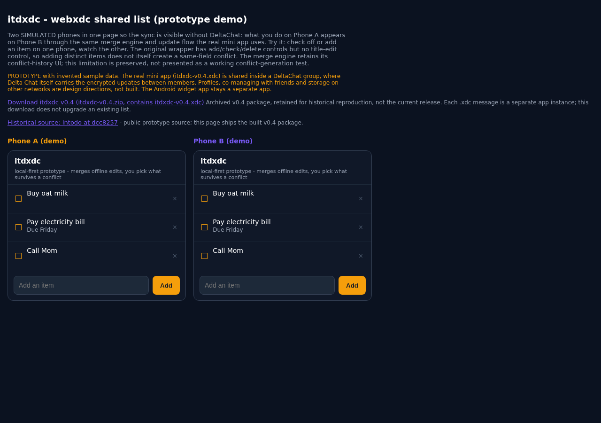

# Historical two-phone shared-list simulation

Open index.html locally in a modern browser. The checked-in bundle runs without installation. Source and pinned build dependencies are included; npm install then npm run build rebuilds it.

Retains the exact original JS merge engine and two simulated phones, synchronous in-page bus, invented sample items, add/check/delete controls, and conflict-history trim UI. Does not run DeltaChat or connect to any actual phone. The original wrapper has no title-edit or offline toggle: adding distinct IDs is not a same-field conflict test. A single old version may be surfaced by the engine heuristic even without a concurrent conflict. The archived v0.4 package is preserved for reproduction only, not as a current release or an upgrade to existing lists. Personal device/status narrative has been removed.

React and ReactDOM licenses are in THIRD_PARTY_LICENSES.txt.

## Preview

[Mobile preview](preview-390.png). These previews show the simulation, not real device execution.
