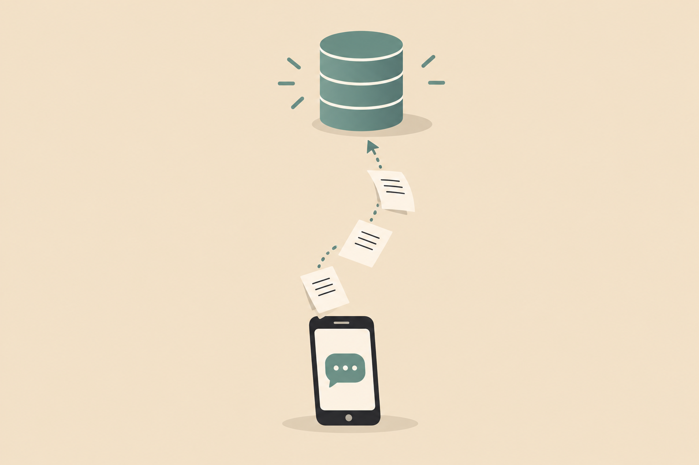

# A phone bot that adds cloud storage

Design note, checked 16 Nov 2026. This is a proposed architecture, not a report on the project's current state: it describes how a storage-saving bot could plug into the itdxdc shared list, and what a real deployment would still need to prove.

## The idea

The webxdc rules deny the mini-app itself any internet access, so itdxdc can never talk to a database directly. But a DeltaChat group can contain more than human profiles: a second profile in the same group - a bot - receives every mini-app update exactly like any member. That bot is the bridge: it listens to the chat it is part of, and saves each list update, in order, to a storage adapter. No webxdc change is needed on the mini-app side.

## How it would work

1. The shared-list mini-app is used in a group, exactly as now.
2. The group also contains the bot profile, running under its own free chatmail address.
3. The bot runs on a phone (for example in Termux, Python plus the official DeltaChat core package) and saves each update, in order, to a storage adapter.
4. The first adapter would be a local database file on the same phone. A cloud variant of the same code would talk to a managed database over plain HTTPS. Credentials would stay only on the phone, never inside the mini-app or the public repo.

Because DeltaChat treats bot and human profiles the same, the bot could also write back into the shared app, so restoring saved state into the list later would be possible.

One encryption caveat to design around: end-to-end encryption ends at the bot. DeltaChat encrypts messages between the group and the bot, and the bot decrypts updates to store them. HTTPS to a cloud database protects the transfer, not the stored data - stored ops would need their own encryption at rest if the database should not be able to read them.

## What a deployment would need to prove

- A phone run. The official DeltaChat core (`deltachat-rpc-server` on PyPI) publishes prebuilt wheels tagged for Android, including arm64. Packaging alone does not establish that pip on Termux will accept and run them; installing and running under Termux still has to be validated in practice.
- A live cloud database. The Turso HTTPS API is documented and needs no extra packages, but an adapter still needs to be exercised against a real account before it counts.
- Ordering and restart behavior: updates saved in order, no gaps or duplicates after the bot goes offline and returns.
- Later, natural extensions: multiple mini-apps at once, a merged current-items view in the database, and encryption of the stored ops.

## Storage order, easiest first

1. **Local file, then Turso.** SQLite locally; the cloud step is one address plus a token over HTTPS.
2. **Upstash or Supabase.** Plain HTTPS APIs with easy drivers. Upstash suits queues more than a main store; Supabase's free project pauses after one idle week.
3. **Neon.** Serverless Postgres with an HTTPS driver; wakes on demand.
4. **Firebase Firestore.** The Android-native option, but service-account sign-in is heavier to set up.
5. **Cloudflare D1.** Needs a small Workers API in front, which is vendor-specific.
6. **MongoDB Atlas M0.** Durable but small (512 MB) and needs a native database driver.
7. **GitHub, encrypted.** Rate limits make it a poor live database; better as an encrypted backup and mirror (see [free-storage-options.md](free-storage-options.md)).
8. **Qdrant and Oracle.** Qdrant is vector search, not a list store. Oracle's free tier offers a real VM but asks for a card and is heavy for this.

## Open decisions for a deployment

- Cloud or not. A local file alone would already make the bot useful on one phone; a cloud database means creating a free account.
- The bot's identity: it would need its own DeltaChat profile, and would appear as a separate member in the group.
- Where the code would live: a folder in this repository rather than a new repo.

## Sources

- [deltachat-rpc-server on PyPI, with the Android packages](https://pypi.org/project/deltachat-rpc-server/) · [DeltaChat JSON-RPC reference](https://py.delta.chat/jsonrpc/reference.html) · [webxdc spec](https://webxdc.org/docs/spec/messenger.html)
- [Turso SQL over HTTP reference](https://docs.turso.tech/sdk/http/reference)

## Architecture illustration

*Illustration only. This is not a screenshot or evidence that the proposed integration has been deployed.*
